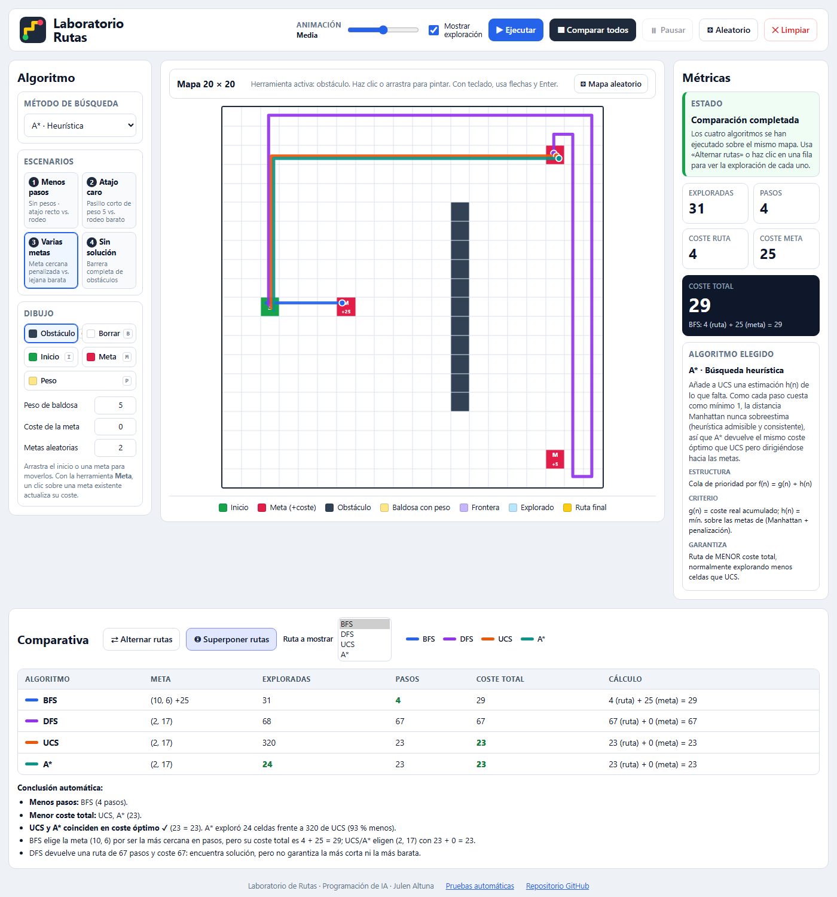
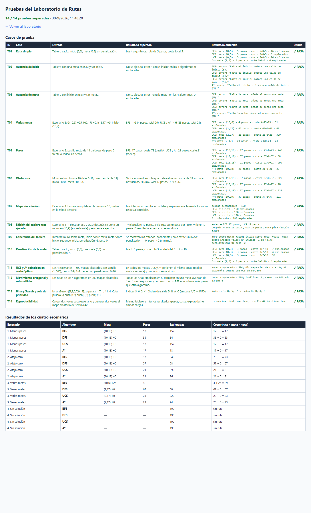
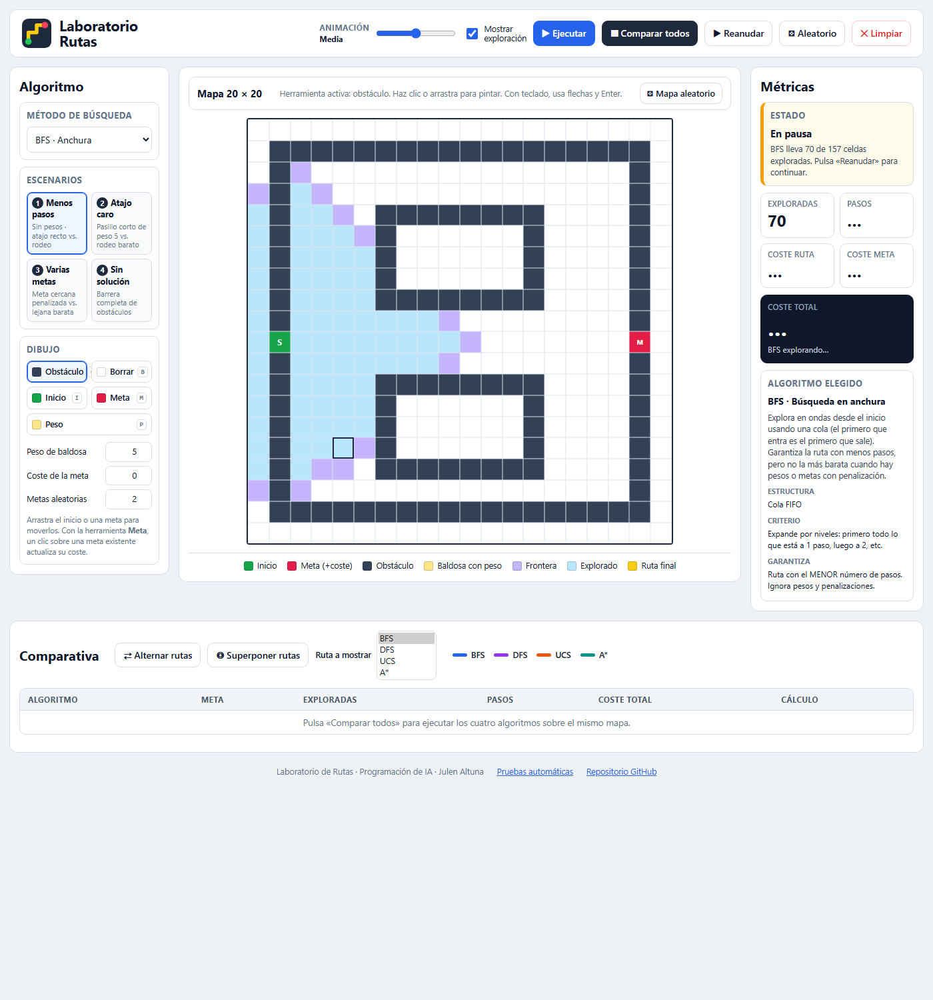
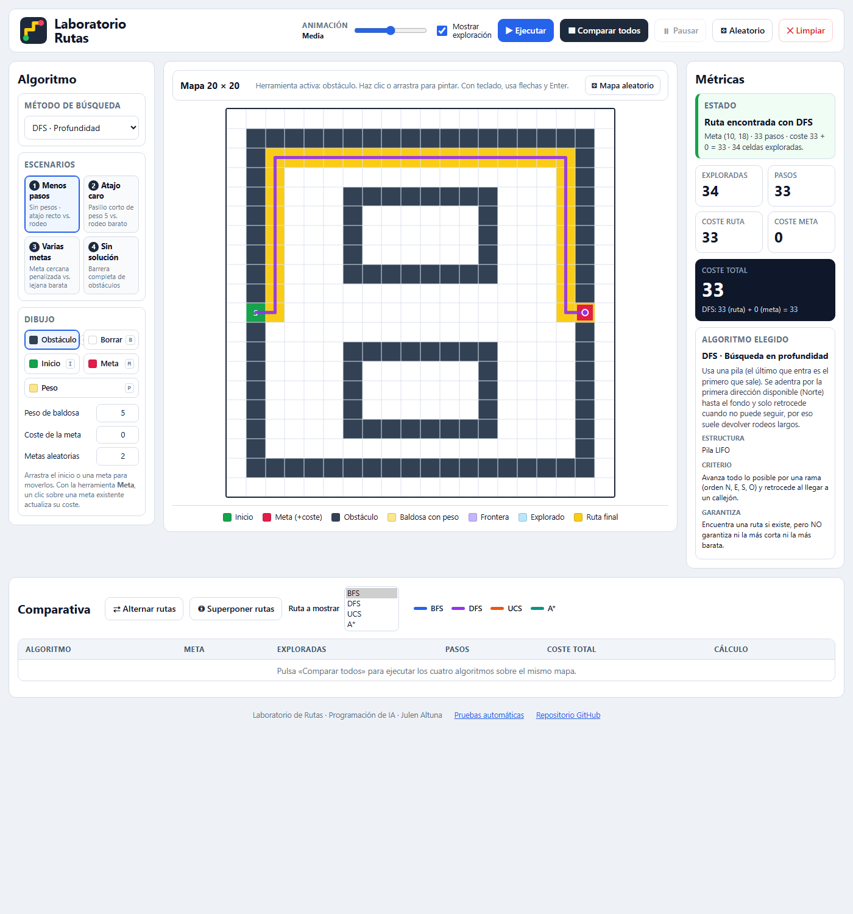
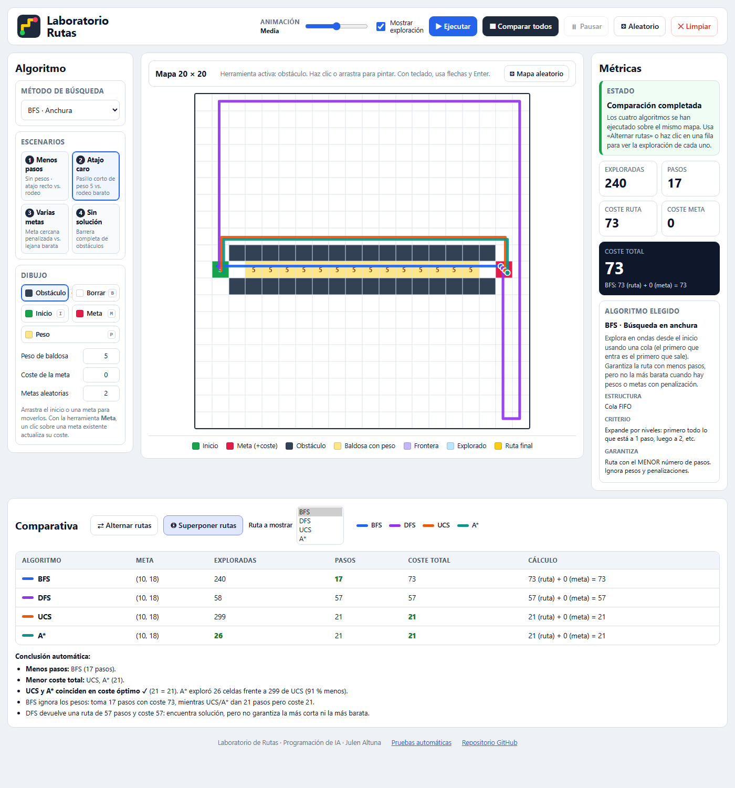
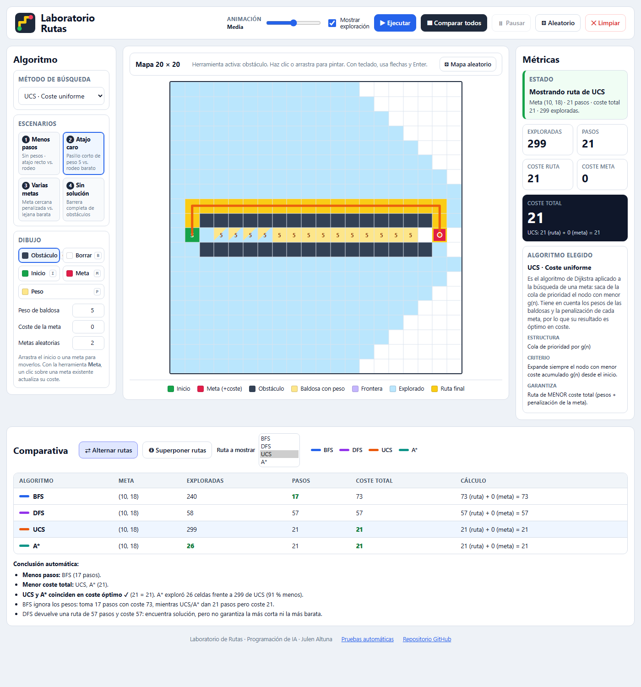
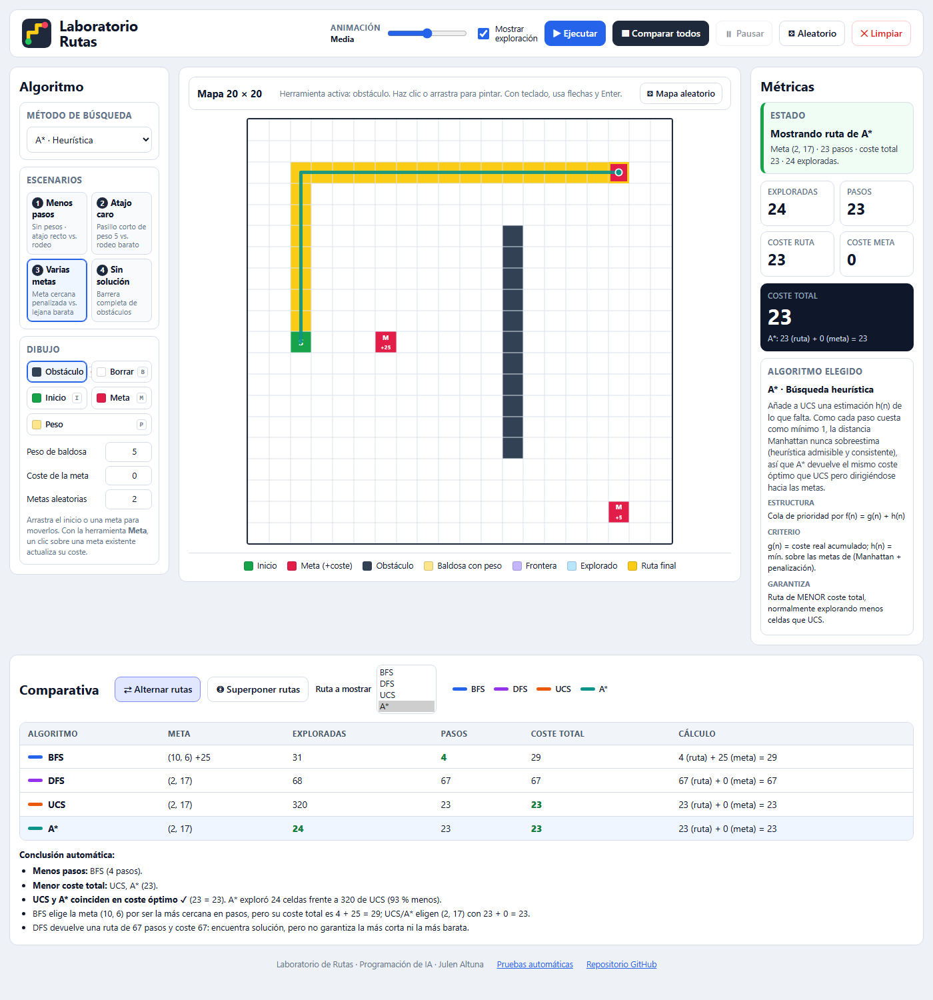
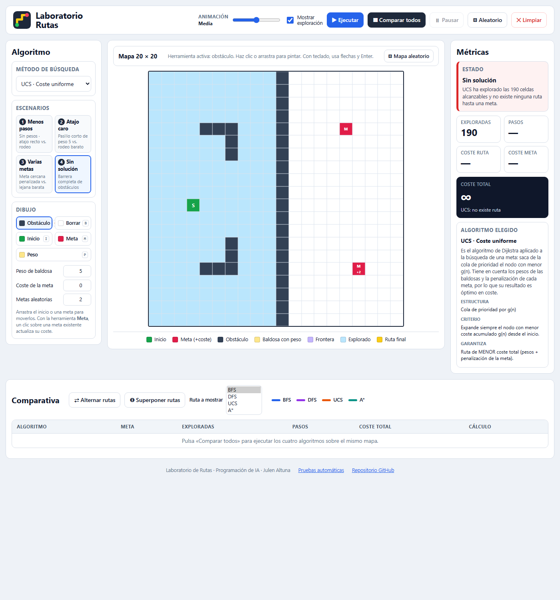

# Laboratorio de Rutas · BFS, DFS, UCS y A*

Aplicación web para **experimentar con algoritmos de búsqueda de rutas** sobre un tablero editable de 20 × 20. Puedes colocar un inicio, una o varias metas (cada una con su coste de penalización), obstáculos y baldosas con peso. Después ves **cómo explora el mapa** cada algoritmo y **comparas los cuatro** sobre el mismo escenario.

> Proyecto de la asignatura **Programación de IA** · Autor: **Julen Altuna**

| | |
|---|---|
| 🌐 **Demo (Netlify)** | https://laboratorio-rutas-julen.netlify.app |
| 📦 **Repositorio** | https://github.com/altu44/laboratorio-rutas |
| 🧪 **Pruebas en el navegador** | [`tests/tests.html`](tests/tests.html) · [demo online](https://laboratorio-rutas-julen.netlify.app/tests/tests.html) |
| 📄 **Informe técnico (PDF)** | [`informe/Informe_Tecnico_Laboratorio_Rutas.pdf`](informe/Informe_Tecnico_Laboratorio_Rutas.pdf) |



---

## 1. Objetivo

Construir un laboratorio web que reproduzca el funcionamiento de cuatro algoritmos de búsqueda vistos en clase (**BFS, DFS, UCS y A\***), para:

- ver paso a paso qué celdas explora cada uno (exploradas, frontera y ruta final);
- medir **celdas exploradas, pasos y coste total** (coste de la ruta + penalización de la meta);
- comparar los cuatro sobre **el mismo mapa** y explicar por qué eligen rutas distintas;
- cargar **cuatro escenarios diseñados** que ponen a prueba decisiones distintas de los algoritmos.

## 2. Tecnologías

| Tecnología | Uso |
|---|---|
| **HTML5** (lenguaje de etiquetado) | Estructura semántica de la página: `header`, `main`, `aside`, `section`, `table`, atributos ARIA. |
| **CSS3** | Maquetación con CSS Grid/Flexbox, tablero siempre cuadrado (`aspect-ratio`), variables de color, diseño adaptable a móvil. |
| **JavaScript (ES2020)** | Lógica del tablero, los cuatro algoritmos, la cola de prioridad con búsqueda binaria, la animación y la interfaz. Sin frameworks ni dependencias. |
| **SVG** | Dibujo de las rutas superpuestas sobre el tablero y del logotipo. |
| **draw.io** | Diseño previo de la estructura de la interfaz (wireframe en [`docs/img`](docs/img/estructura_laboratorio.drawio.png)). |
| **Git + GitHub** | Control de versiones y repositorio público. |
| **Netlify** | Despliegue del sitio estático (configuración en [`netlify.toml`](netlify.toml)). |
| **Google Chrome (DevTools y modo *headless*)** | Depuración, ejecución de las pruebas y generación reproducible de capturas y del PDF. |
| **Visual Studio Code** + **Claude Code** | Editor y asistente de IA utilizados durante el desarrollo. |

No hace falta instalar nada: es un sitio **100 % estático** que funciona abriendo `index.html` en cualquier navegador moderno.

## 3. Instrucciones de uso

### Ejecutar en local

```bash
git clone https://github.com/altu44/laboratorio-rutas.git
cd laboratorio-rutas
# Opción 1: abrir index.html con doble clic.
# Opción 2: servidor local (cualquiera sirve), por ejemplo:
python -m http.server 8000   # y abrir http://localhost:8000
```

### Interfaz (estructura diseñada en draw.io)

| Zona | Contenido |
|---|---|
| **Cabecera** | Velocidad de animación (Muy lenta → Muy rápida), *Mostrar exploración*, **Ejecutar**, **Comparar todos**, **Pausar/Reanudar**, **Aleatorio** y **Limpiar**. |
| **Algoritmo** (izquierda) | Método de búsqueda (BFS, DFS, UCS, A\*), los **4 escenarios** y las herramientas de **dibujo**: obstáculo, borrar, inicio, meta y peso, con los campos *peso de baldosa*, *coste de la meta* y *metas aleatorias*. |
| **Mapa** (centro) | Tablero 20 × 20, herramienta activa, botón *Mapa aleatorio* y leyenda de colores. |
| **Métricas** (derecha) | Estado, exploradas, pasos, coste de ruta, coste de meta, **coste total** con su cálculo y explicación del algoritmo elegido. |
| **Comparativa** (abajo) | *Alternar rutas*, *Superponer rutas*, lista *Ruta a mostrar*, colores por algoritmo, tabla (meta, exploradas, pasos, coste total, cálculo) y **conclusión automática**. |

### Editar el tablero

- **Ratón / táctil:** elige una herramienta y haz clic o **arrastra** para pintar. Arrastra el **inicio** o una **meta** para moverlos.
- **Teclado:** enfoca el tablero, muévete con las **flechas** y aplica la herramienta con **Enter** (Mayús + flechas pinta mientras te mueves). Atajos: `O` obstáculo, `B` borrar, `I` inicio, `M` meta, `P` peso.
- **Coherencia:** cada celda tiene un único tipo, así que nunca puede ser muro y meta a la vez. Solo hay un inicio (colocar otro lo mueve), no se puede poner inicio sobre meta ni meta sobre inicio, y los obstáculos/pesos no sobrescriben inicio ni metas. Pesos entre 2 y 99; penalizaciones enteras **no negativas**.
- Al **editar después de ejecutar**, los resultados anteriores se invalidan: el mapa se limpia de rutas, las métricas vuelven a “—” y la tabla comparativa se marca como desactualizada.

### Reglas del modelo

- Movimiento **ortogonal** (N, E, S, O), sin diagonales. Orden fijo de vecinos: Norte, Este, Sur, Oeste.
- Entrar en una celda normal cuesta **1**; en una baldosa con peso, **su valor**.
- **Coste total = coste de la ruta + penalización de la meta alcanzada.**
- *Exploradas* = nodos sacados de la frontera y expandidos.

### Parámetros de URL (reproducibilidad)

| Parámetro | Ejemplo | Efecto |
|---|---|---|
| `escenario` | `?escenario=3` | Carga uno de los 4 escenarios. |
| `semilla`, `metas`, `pen` | `?semilla=42&metas=3&pen=10` | Mapa aleatorio reproducible. |
| `alg`, `vel`, `expl` | `&alg=astar&vel=5&expl=0` | Algoritmo, velocidad y mostrar exploración. |
| `guion` | `&guion=compare;show:ucs` | Acciones: `run`, `anim:N`, `compare`, `overlay`, `show:alg`, `wall:r,c`, `erase:r,c`, `weight:r,c,w`, `start:r,c`, `goal:r,c,p`. |

## 4. Algoritmos

| | Estructura | Criterio de expansión | Completo | Óptimo en pasos | Óptimo en coste |
|---|---|---|:-:|:-:|:-:|
| **BFS** | Cola FIFO | Por niveles (nº de pasos) | ✔ | ✔ | ✘ |
| **DFS** | Pila LIFO | La rama más profunda primero (N, E, S, O) | ✔ (grafo finito) | ✘ | ✘ |
| **UCS** | Cola de prioridad por `g(n)` | Menor coste acumulado | ✔ | ✘ | ✔ |
| **A\*** | Cola de prioridad por `f(n) = g(n) + h(n)` | Menor coste estimado total | ✔ | ✘ | ✔ |

- **BFS** explora en ondas; garantiza la ruta con **menos pasos**, pero ignora pesos y penalizaciones.
- **DFS** se adentra por la primera dirección posible y retrocede en los callejones; encuentra ruta si existe, pero **no garantiza** ni la más corta ni la más barata.
- **UCS** (Dijkstra) expande siempre el nodo de menor coste acumulado. Con **varias metas**, al expandir una meta inserta un “nodo final” con prioridad `g(meta) + penalización`; la búsqueda termina cuando ese nodo final sale de la cola, así compara correctamente metas cercanas caras con metas lejanas baratas.
- **A\*** usa la heurística `h(n) = min sobre metas (Manhattan(n, meta) + penalización(meta))`. Como cada paso cuesta al menos 1, es **admisible y consistente**: obtiene el mismo coste óptimo que UCS explorando muchas menos celdas.
- **Binary Search:** la cola de prioridad de UCS y A\* se mantiene **ordenada** y cada inserción localiza su posición con **búsqueda binaria** en O(log n) (`js/priorityQueue.js`). Los empates se resuelven por orden de llegada, lo que hace los resultados deterministas.

## 5. Los cuatro escenarios

Se cargan desde el panel izquierdo o con `?escenario=N`; siempre producen el mismo tablero y los mismos resultados.

| # | Escenario | Pone a prueba | BFS | DFS | UCS | A\* | Conclusión |
|---|---|---|---|---|---|---|---|
| 1 | **Menos pasos** | Desvíos y caminos de distinta longitud, sin pesos | 17 pasos · coste 17 · 157 expl. | **33 pasos** · coste 33 · 34 expl. | 17 · 17 · 157 | 17 · 17 · **18** | BFS da los pasos mínimos; DFS, que prueba primero el Norte, se mete por el pasillo superior y da un rodeo de casi el doble. |
| 2 | **Atajo caro** | Ruta corta con baldosas de peso 5 frente a rodeo barato | 17 pasos · **coste 73** · 240 | 57 · 57 · 58 | 21 pasos · **coste 21** · 299 | 21 · 21 · **26** | BFS prefiere el pasillo corto aunque caro; UCS y A\* eligen el rodeo más largo pero mucho más barato. |
| 3 | **Varias metas** | Meta cercana con penalización +25 frente a lejanas baratas | Meta G (10,6): 4 pasos · 4 + 25 = **29** | Meta H: 67 · 67 | Meta H (2,17): 23 + 0 = **23** · 320 | 23 + 0 = **23** · **24** | BFS se queda con la meta más cercana en pasos; UCS y A\* justifican su elección por coste total (23 < 28 de I < 29 de G). |
| 4 | **Sin solución** | Barrera completa de obstáculos | sin ruta · 190 | sin ruta · 190 | sin ruta · 190 | sin ruta · 190 | Los cuatro terminan tras explorar toda la zona alcanzable e informan de que no existe ruta. |

En los cuatro escenarios **UCS y A\* coinciden en coste óptimo**, y A\* explora entre un 89 % y un 93 % menos celdas que UCS cuando hay solución.

## 6. Pruebas

Las pruebas automáticas están en [`tests/tests.html`](tests/tests.html) (se ejecutan solas al abrir la página). Resultado actual: **14 / 14 pruebas superadas**. La documentación completa de cada caso, con entrada, resultado esperado, resultado obtenido y captura, está en [`docs/pruebas.md`](docs/pruebas.md).

| ID | Caso | Resultado |
|---|---|:-:|
| T01 | Ruta simple | ✔ |
| T02 | Ausencia de inicio | ✔ |
| T03 | Ausencia de meta | ✔ |
| T04 | Varias metas | ✔ |
| T05 | Pesos | ✔ |
| T06 | Obstáculos | ✔ |
| T07 | Mapa sin solución | ✔ |
| T08 | Edición del tablero tras ejecutar | ✔ |
| T09 | Coherencia del tablero | ✔ |
| T10 | Penalización de la meta | ✔ |
| T11 | **UCS y A\* coinciden en coste óptimo** (4 escenarios + 500 mapas aleatorios) | ✔ |
| T12 | Movimiento ortogonal y rutas válidas (200 mapas aleatorios) | ✔ |
| T13 | Binary Search y cola de prioridad | ✔ |
| T14 | Reproducibilidad de escenarios y semillas | ✔ |



## 7. Capturas

| Exploración en curso (BFS, pausado) | Escenario 1 · DFS da un rodeo |
|---|---|
|  |  |
| **Escenario 2 · rutas superpuestas** | **Escenario 2 · UCS elige el rodeo barato** |
|  |  |
| **Escenario 3 · A\* va a la meta barata** | **Escenario 4 · sin solución** |
|  |  |

Vista en móvil: [`docs/capturas/13_movil.png`](docs/capturas/13_movil.png).

## 8. Estructura del proyecto

```
laboratorio-rutas/
├── index.html              # Estructura de la interfaz (HTML5)
├── css/styles.css          # Estilos y diseño adaptable
├── js/
│   ├── grid.js             # Modelo del tablero (tipos de celda, edición coherente, mapas)
│   ├── priorityQueue.js    # Binary Search + cola de prioridad estable
│   ├── algorithms.js       # BFS, DFS, UCS y A* (funciones puras)
│   ├── scenarios.js        # Los 4 escenarios diseñados
│   └── app.js              # Interfaz: pintado, eventos, animación, comparativa
├── tests/                  # Pruebas automáticas en el navegador
├── docs/                   # Capturas, wireframe de draw.io y documentación de pruebas
├── informe/                # Informe técnico (HTML fuente + PDF)
└── netlify.toml            # Configuración de despliegue
```

## 9. Despliegue en Netlify

El sitio no necesita compilación. En Netlify: **Add new site → Import an existing project → GitHub →** `altu44/laboratorio-rutas`, *Build command* vacío y *Publish directory* `.` (ya definido en `netlify.toml`). Cada `git push` a `main` vuelve a desplegar automáticamente.

## 10. Limitaciones

- Tamaño fijo 20 × 20 y solo movimiento ortogonal (sin diagonales).
- Los pesos son enteros entre 2 y 99 y las penalizaciones enteros entre 0 y 999; no se admiten costes negativos (romperían la optimalidad de UCS/A\*).
- DFS depende del orden de vecinos elegido (N, E, S, O); con otro orden daría rutas distintas.
- En DFS la frontera puede contener duplicados (se descartan al sacarlos), por eso su contador de frontera no es comparable al de los demás.
- Los mapas dibujados a mano no se guardan entre sesiones (se pueden reproducir con los parámetros de URL `mapa`/`semilla`).
- La animación se limita a la velocidad del navegador; en “Muy rápida” se dibujan varias celdas por fotograma.

## 11. Enlaces

- Aplicación desplegada: https://laboratorio-rutas-julen.netlify.app
- Repositorio: https://github.com/altu44/laboratorio-rutas
- Informe técnico: [`informe/Informe_Tecnico_Laboratorio_Rutas.pdf`](informe/Informe_Tecnico_Laboratorio_Rutas.pdf)
- Documentación de pruebas: [`docs/pruebas.md`](docs/pruebas.md)
