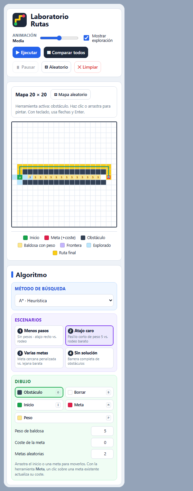

# Laboratorio de Rutas

Trabajo de la asignatura **Programación de IA**, hecho por **Julen Altuna**.

Es una aplicación web en la que se puede dibujar un mapa de 20 x 20 y ver cómo lo recorren los algoritmos de búsqueda que hemos visto en clase: **BFS, DFS, UCS y A\***. En el mapa se pone un inicio, una o varias metas, obstáculos y baldosas que cuestan más de pasar, y después se puede ver paso a paso qué celdas va explorando cada algoritmo y comparar los cuatro sobre el mismo mapa.

- **Aplicación en Vercel:** https://laboratorio-rutas.vercel.app
- **Repositorio:** https://github.com/altu44/laboratorio-rutas
- **Pruebas:** [`tests/tests.html`](tests/tests.html) (también online en https://laboratorio-rutas.vercel.app/tests/tests.html)
- **Informe técnico:** [`informe/Informe_Tecnico_Laboratorio_Rutas.pdf`](informe/Informe_Tecnico_Laboratorio_Rutas.pdf)


## Objetivo

La idea del trabajo es tener un "laboratorio" donde poder probar los algoritmos de búsqueda y entender por qué cada uno elige una ruta distinta. Para eso la aplicación tenía que:

- dejar editar el tablero sin que se queden estados raros (por ejemplo una celda que sea muro y meta a la vez),
- enseñar la exploración mientras pasa, con la ruta final y el caso de que no haya solución,
- mostrar al menos las celdas exploradas, los pasos y el coste total,
- comparar los cuatro algoritmos sobre el mismo mapa,
- y tener cuatro escenarios diseñados por mí que pongan a prueba una decisión distinta de los algoritmos.

## Tecnologías

He hecho la aplicación con **HTML, CSS y JavaScript**, sin frameworks ni librerías. Lo he elegido así porque es lo que entiende cualquier navegador directamente, no hay que instalar nada y se puede subir tal cual a Vercel.

- **HTML5** para la estructura de la página (cabecera, paneles, mapa, tabla).
- **CSS3** para el diseño. El tablero usa CSS Grid y `aspect-ratio` para que siempre sea cuadrado, y la página se adapta al móvil.
- **JavaScript** para todo lo demás: el tablero, los cuatro algoritmos, la cola de prioridad con búsqueda binaria, la animación y la comparativa.
- **SVG** para dibujar las rutas encima del mapa.
- **draw.io** para hacer antes la estructura de la pantalla ([wireframe](docs/img/estructura_laboratorio.drawio.png)).
- **Git y GitHub** para el control de versiones y **Vercel** para publicarlo.
- **Chrome** para probar, sacar las capturas y pasar el informe a PDF.
- **VS Code** como editor y **Claude Code** como asistente de IA durante el desarrollo.

## Cómo usarlo

No hace falta instalar nada. Se puede abrir directamente en Vercel o descargar el repositorio y abrir `index.html` con doble clic:

```bash
git clone https://github.com/altu44/laboratorio-rutas.git
```

Si se prefiere usar un servidor local, vale cualquiera, por ejemplo `python -m http.server 8000` y abrir `http://localhost:8000`.

### La pantalla

La estructura la diseñé primero en draw.io y la aplicación sigue esa misma distribución:

- **Arriba:** la velocidad de la animación, la casilla de mostrar exploración y los botones de Ejecutar, Comparar todos, Pausar, Aleatorio y Limpiar (este último en rojo porque borra el tablero).
- **Izquierda (Algoritmo):** el desplegable para elegir algoritmo, los cuatro escenarios y las herramientas de dibujo (obstáculo, borrar, inicio, meta y peso), con los campos de peso de la baldosa, coste de la meta y número de metas aleatorias.
- **Centro:** el mapa de 20 x 20, la herramienta que está activa y la leyenda de colores.
- **Derecha (Métricas):** el estado, las celdas exploradas, los pasos, el coste de la ruta, el coste de la meta, el coste total con su cálculo y una explicación del algoritmo elegido.
- **Abajo (Comparativa):** los botones de alternar y superponer rutas, el desplegable para elegir qué ruta ver y la tabla con los cuatro algoritmos.

### Editar el mapa

- Con el ratón se elige una herramienta y se hace clic o se arrastra por el mapa. El inicio y las metas se pueden mover arrastrándolos.
- Con el teclado: se hace clic en el mapa, se mueve con las flechas y se aplica con Enter. También hay atajos: `O` obstáculo, `B` borrar, `I` inicio, `M` meta y `P` peso.
- Cada celda solo puede ser una cosa, así que no puede haber estados incoherentes. Solo hay un inicio (si pones otro, se mueve), no se puede poner el inicio encima de una meta ni al revés, y los obstáculos y los pesos no pisan ni el inicio ni las metas.
- Si se cambia el mapa después de ejecutar, los resultados anteriores se borran y la tabla de la comparativa avisa de que está desactualizada.

### Reglas

- Solo se mueve en horizontal y vertical, sin diagonales. Los vecinos se miran siempre en el mismo orden: Norte, Este, Sur y Oeste.
- Entrar en una celda normal cuesta 1 y en una baldosa con peso cuesta su valor (de 2 a 99).
- Cada meta puede tener una penalización, que tiene que ser 0 o más.
- **Coste total = coste de la ruta + penalización de la meta a la que se llega.**
- Las "exploradas" son las celdas que el algoritmo saca de la frontera y expande.

### Parámetros de la URL

Para que todo se pueda repetir igual (y para sacar las capturas) la aplicación acepta parámetros en la URL:

- `?escenario=3` carga uno de los escenarios.
- `?semilla=42&metas=3` genera siempre el mismo mapa aleatorio.
- `&alg=astar` elige el algoritmo, `&vel=5` la velocidad y `&expl=0` quita la exploración.
- `&guion=compare;show:ucs` ejecuta acciones seguidas: `run`, `anim:N`, `compare`, `overlay`, `show:alg`, `wall:r,c`, `erase:r,c`, `weight:r,c,w`, `start:r,c` y `goal:r,c,p`.

## Algoritmos

- **BFS (búsqueda en anchura):** usa una cola, así que explora por niveles: primero lo que está a 1 paso, luego a 2... Por eso siempre encuentra la ruta con **menos pasos**, pero no tiene en cuenta ni los pesos ni las penalizaciones.
- **DFS (búsqueda en profundidad):** usa una pila y se mete por el primer camino que encuentra (empezando por el Norte) hasta que no puede seguir, y entonces vuelve atrás. Si hay ruta la encuentra, pero **no tiene por qué ser ni la más corta ni la más barata**.
- **UCS (coste uniforme):** usa una cola de prioridad y siempre expande la celda con menor coste acumulado. Así encuentra la ruta **más barata**. Con varias metas, cuando llega a una no para directamente: mete en la cola un "nodo final" con el coste de la ruta más la penalización de esa meta, y solo termina cuando sale ese nodo. Así puede comparar bien una meta cercana pero cara con otra más lejana pero barata.
- **A\*:** es como UCS pero añadiendo una estimación de lo que falta: `f(n) = g(n) + h(n)`. Como heurística uso la distancia Manhattan a la meta más la penalización de la meta, quedándome con la menor. Como cada paso cuesta como mínimo 1, nunca se pasa de lo real, así que A\* saca **el mismo coste que UCS pero explorando muchas menos celdas**.
- **Binary Search (búsqueda binaria):** la uso en la cola de prioridad de UCS y A\*. La lista está siempre ordenada y cada elemento nuevo se mete en su sitio buscándolo con búsqueda binaria, en vez de recorrer toda la lista. Si dos elementos empatan, sale antes el que entró antes, así los resultados siempre son los mismos.

| | Estructura | Menos pasos | Menor coste | Usa pesos |
|---|---|:-:|:-:|:-:|
| **BFS** | Cola | Sí | No | No |
| **DFS** | Pila | No | No | No |
| **UCS** | Cola de prioridad por g(n) | No | Sí | Sí |
| **A\*** | Cola de prioridad por g(n) + h(n) | No | Sí | Sí |

## Los cuatro escenarios

Están en el panel de la izquierda y se pueden cargar también con `?escenario=N`. Cada uno lo diseñé para probar una cosa distinta:

| Escenario | Qué pone a prueba | BFS | DFS | UCS | A\* | Conclusión |
|---|---|---|---|---|---|---|
| **1. Menos pasos** | Caminos de distinta longitud sin pesos | 17 pasos, 157 exploradas | **33 pasos**, 34 exploradas | 17 pasos, 157 exploradas | 17 pasos, **18 exploradas** | BFS da la ruta más corta. DFS tira primero hacia el Norte, se mete por el pasillo de arriba y da un rodeo de casi el doble. |
| **2. Atajo caro** | Un pasillo corto con baldosas de peso 5 contra un rodeo sin pesos | 17 pasos, **coste 73** | 57 pasos, coste 57 | 21 pasos, **coste 21** | 21 pasos, coste 21, 26 exploradas | BFS va por el pasillo porque tiene menos pasos, aunque sea mucho más caro. UCS y A\* dan el rodeo, que cuesta menos de un tercio. |
| **3. Varias metas** | Una meta cerca con penalización +25 y otras más lejos y baratas | Meta cercana: 4 + 25 = **29** | 67 pasos, coste 67 | Meta lejana: 23 + 0 = **23** | 23 + 0 = 23, 24 exploradas | BFS se queda con la meta más cercana. UCS y A\* comparan el coste total (23 frente a 28 y 29) y van a la lejana. |
| **4. Sin solución** | Una barrera de obstáculos que no deja llegar a las metas | Sin ruta, 190 exploradas | Sin ruta, 190 | Sin ruta, 190 | Sin ruta, 190 | Los cuatro exploran toda la zona a la que pueden llegar, terminan y avisan de que no hay ruta. |

En los cuatro escenarios **UCS y A\* coinciden en el coste óptimo**, y cuando hay solución A\* explora entre un 89 % y un 93 % menos celdas que UCS.

## Pruebas

Las pruebas están en [`tests/tests.html`](tests/tests.html) y se ejecutan solas al abrir la página. Usan el mismo código que la aplicación. Ahora mismo pasan las **14**. Cada caso con su entrada, resultado esperado, resultado obtenido y captura está explicado en [`docs/pruebas.md`](docs/pruebas.md).

| ID | Caso | Resultado |
|---|---|:-:|
| T01 | Ruta simple | ✔ |
| T02 | Sin inicio | ✔ |
| T03 | Sin meta | ✔ |
| T04 | Varias metas | ✔ |
| T05 | Pesos | ✔ |
| T06 | Obstáculos | ✔ |
| T07 | Mapa sin solución | ✔ |
| T08 | Editar el tablero después de ejecutar | ✔ |
| T09 | Coherencia del tablero | ✔ |
| T10 | Penalización de la meta | ✔ |
| T11 | UCS y A\* coinciden en coste óptimo (4 escenarios + 500 mapas aleatorios) | ✔ |
| T12 | Rutas válidas y sin diagonales (200 mapas aleatorios) | ✔ |
| T13 | Binary Search y cola de prioridad | ✔ |
| T14 | Los escenarios y las semillas siempre dan lo mismo | ✔ |

## Capturas

Todas las capturas se pueden repetir abriendo la aplicación con la URL que pongo debajo de cada una.

### Exploración en curso


BFS en el escenario 1, pausado a mitad de la búsqueda. En azul claro están las celdas que ya ha explorado y en lila la frontera, que son las que tiene pendientes. La celda con el borde negro es la que acaba de expandir. Se ve que BFS avanza como una onda alrededor del inicio, y en el panel de la derecha pone cuántas celdas lleva y que está en pausa. URL: `?escenario=1&guion=anim:70`

### Escenario 1: DFS da un rodeo


Aquí está el resultado de DFS en el escenario 1. Como siempre prueba primero el Norte, en vez de ir recto hacia la meta sube por el pasillo de la izquierda, cruza por arriba y baja por la derecha. Encuentra la meta, pero con 33 pasos, cuando BFS lo hace en 17. URL: `?escenario=1&alg=dfs&guion=run`

### Escenario 2: las cuatro rutas superpuestas


Después de pulsar "Comparar todos" se dibujan las cuatro rutas a la vez, cada una con su color. La azul (BFS) va recta por el pasillo de baldosas de peso 5. La naranja (UCS) y la verde (A\*) salen del pasillo y lo rodean por arriba, porque aunque sean más pasos es mucho más barato. La morada es DFS. En la tabla de abajo se ven los números: BFS tiene 17 pasos pero coste 73, y UCS y A\* tienen 21 pasos pero coste 21. URL: `?escenario=2&guion=compare`

### Escenario 2: la ruta de UCS


La misma comparativa, pero eligiendo UCS en "Ruta a mostrar". Así se ve solo su ruta y todas las celdas que ha explorado. Explora casi todo el mapa (299 celdas) porque va abriendo por orden de coste en todas las direcciones, sin saber dónde está la meta. URL: `?escenario=2&guion=compare;show:ucs`

### Escenario 3: A\* va a la meta barata


En el escenario 3 hay una meta muy cerca del inicio pero con +25 de penalización, y otras dos más lejos. A\* va directamente a la de arriba a la derecha, que no tiene penalización, y solo explora 24 celdas porque la heurística le dice hacia dónde ir. En las métricas sale el cálculo: 23 de ruta + 0 de meta = 23. URL: `?escenario=3&guion=compare;show:astar`

### Escenario 4: sin solución


La columna de obstáculos del centro no deja pasar a la derecha, donde están las metas. UCS explora toda la parte izquierda (190 celdas), termina y en el estado pone "Sin solución". El coste total sale como ∞. Los otros tres algoritmos hacen lo mismo. URL: `?escenario=4&alg=ucs&guion=run`

### Página de pruebas


Es lo que se ve al abrir `tests/tests.html`. Arriba sale el resumen (14 de 14 superadas) y después una fila por prueba con la entrada, lo esperado, lo obtenido y si pasa. Al final hay otra tabla con los resultados de los cuatro escenarios.

### En el móvil



En pantallas estrechas los paneles se ponen uno debajo de otro y el mapa queda arriba del todo, para que se pueda usar también desde el móvil. Se puede dibujar con el dedo igual que con el ratón.

## Estructura del proyecto

```
laboratorio-rutas/
├── index.html              # estructura de la página
├── css/styles.css          # estilos
├── js/
│   ├── grid.js             # el tablero: tipos de celda, edición, mapas
│   ├── priorityQueue.js    # búsqueda binaria y cola de prioridad
│   ├── algorithms.js       # BFS, DFS, UCS y A*
│   ├── scenarios.js        # los 4 escenarios
│   └── app.js              # la interfaz: dibujar, animar, comparar
├── tests/                  # pruebas automáticas
├── docs/                   # capturas, wireframe de draw.io y pruebas
├── informe/                # informe técnico (HTML y PDF)
└── vercel.json             # configuración de Vercel
```

Los algoritmos no tocan la página para nada: reciben el tablero y devuelven el resultado. Así los puedo usar tanto en la aplicación como en las pruebas.

## Despliegue en Vercel

Como es una web estática no hace falta compilar nada. En Vercel: **Add New → Project →** importar `altu44/laboratorio-rutas`, dejar el *Framework Preset* en "Other" y darle a **Deploy**. Cada vez que hago `git push` a `main`, Vercel vuelve a publicar la web solo.

## Limitaciones

- El tablero siempre es de 20 x 20 y no hay movimiento en diagonal.
- Los pesos van de 2 a 99 y las penalizaciones de 0 a 999. No se pueden poner costes negativos, porque entonces UCS y A\* dejarían de dar la ruta óptima.
- La ruta de DFS depende del orden en el que miro los vecinos (N, E, S, O). Con otro orden saldría otra.
- En DFS la frontera puede tener celdas repetidas (se descartan cuando salen de la pila).
- Los mapas que se dibujan a mano no se guardan al cerrar la página. Se pueden repetir con los parámetros de la URL.

## Enlaces

- Aplicación: https://laboratorio-rutas.vercel.app
- Repositorio: https://github.com/altu44/laboratorio-rutas
- Informe técnico: [`informe/Informe_Tecnico_Laboratorio_Rutas.pdf`](informe/Informe_Tecnico_Laboratorio_Rutas.pdf)
- Pruebas: [`docs/pruebas.md`](docs/pruebas.md)
