# Documentación de pruebas

Todas las pruebas son **reproducibles**:

- **Pruebas automáticas:** abrir [`tests/tests.html`](../tests/tests.html). La página ejecuta los casos T01–T14 con los mismos módulos que usa la aplicación (`grid.js`, `priorityQueue.js`, `algorithms.js`, `scenarios.js`) y muestra entrada, esperado, obtenido y estado.
- **Pruebas en la interfaz:** cada captura se obtiene abriendo `index.html` con los parámetros de URL indicados (por ejemplo `index.html?escenario=1&guion=erase:10,1;run`), que ejecutan las mismas funciones que los botones.

**Resultado de la última ejecución: 14 / 14 pruebas superadas** (Chrome 30/09/2026).

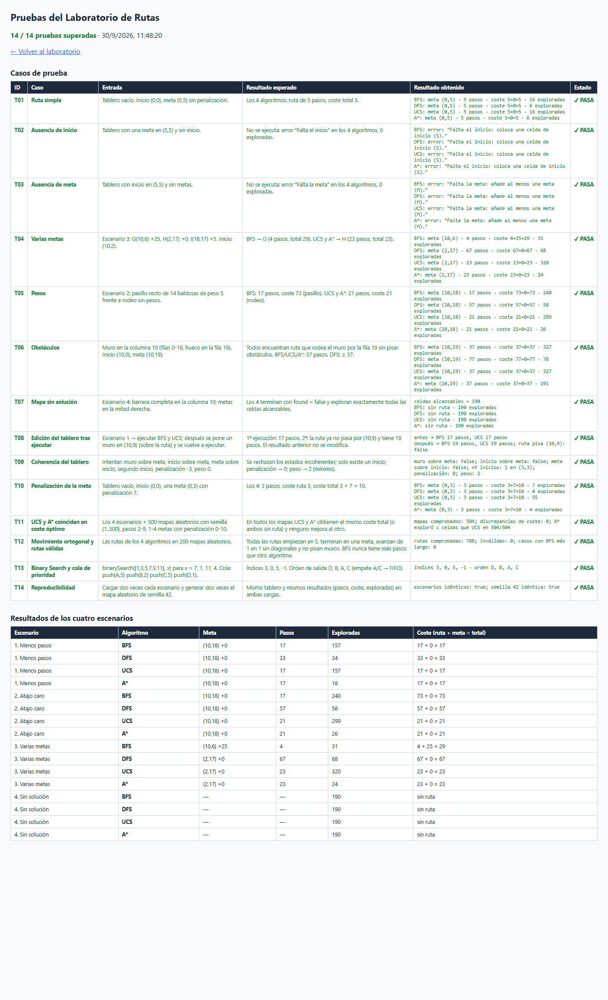

Coordenadas en formato (fila, columna), de 0 a 19.

---

## T01 · Ruta simple

| | |
|---|---|
| **Entrada** | Tablero vacío. Inicio (0,0), meta (0,5) sin penalización. URL: `?mapa=S....G.............../…&guion=compare` |
| **Esperado** | Los 4 algoritmos: ruta de 5 pasos, coste total 5. |
| **Obtenido** | BFS: 5 pasos · coste 5 + 0 = 5 · 16 exploradas DFS: 5 pasos · coste 5 · 6 exploradas UCS: 5 pasos · coste 5 · 16 exploradas A\*: 5 pasos · coste 5 · 6 exploradas |
| **Estado** | ✔ PASA |

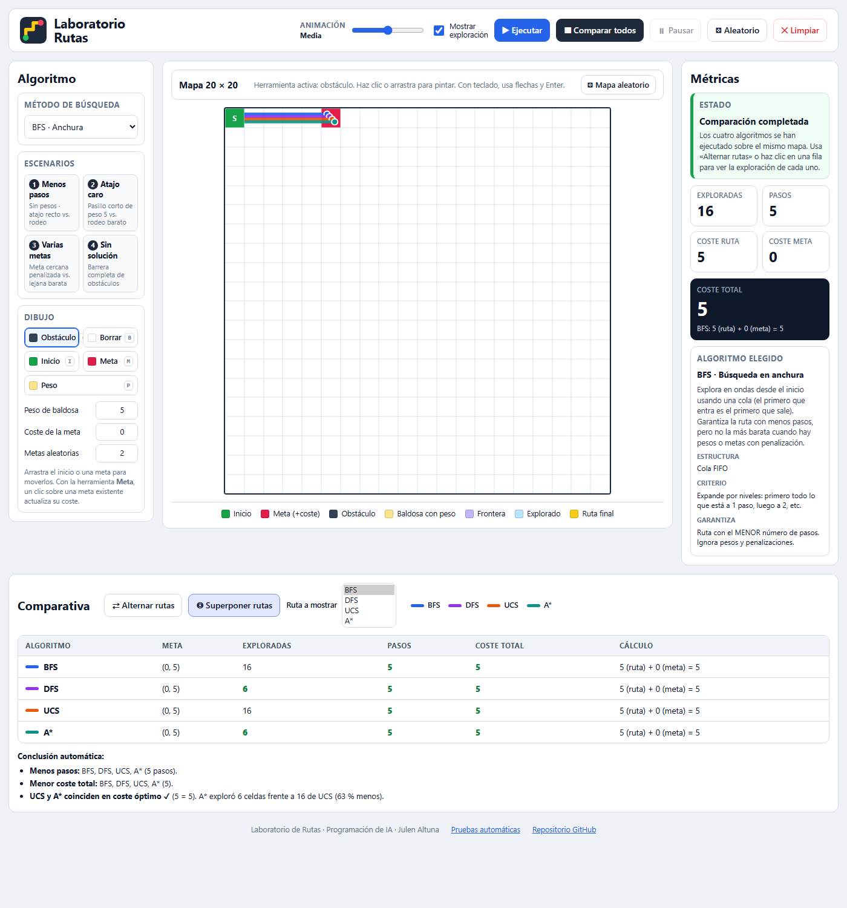

## T02 · Ausencia de inicio

| | |
|---|---|
| **Entrada** | Escenario 1 y se borra el inicio (10,1); después se pulsa Ejecutar. URL: `?escenario=1&guion=erase:10,1;run` |
| **Esperado** | No se ejecuta ningún algoritmo; el estado avisa “Falta el inicio”; 0 exploradas. |
| **Obtenido** | Los 4 devuelven `error: "Falta el inicio: coloca una celda de inicio (S)."` y 0 exploradas. En la interfaz: estado **“No se puede ejecutar”** y métricas “—”. |
| **Estado** | ✔ PASA |

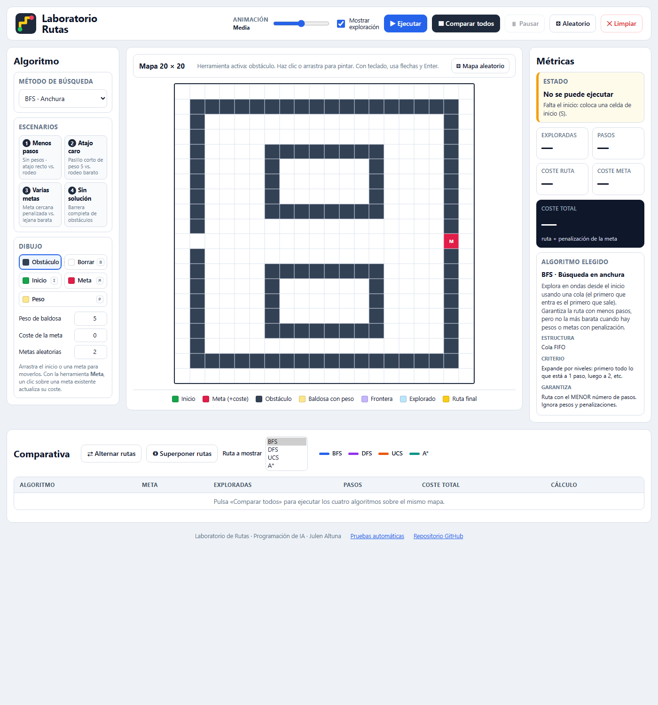

## T03 · Ausencia de meta

| | |
|---|---|
| **Entrada** | Escenario 1 y se borra la única meta (10,18); después Ejecutar. URL: `?escenario=1&guion=erase:10,18;run` |
| **Esperado** | No se ejecuta; aviso “Falta la meta”; 0 exploradas. |
| **Obtenido** | Los 4 devuelven `error: "Falta la meta: añade al menos una meta (M)."` y 0 exploradas. En la interfaz: **“No se puede ejecutar”**. |
| **Estado** | ✔ PASA |

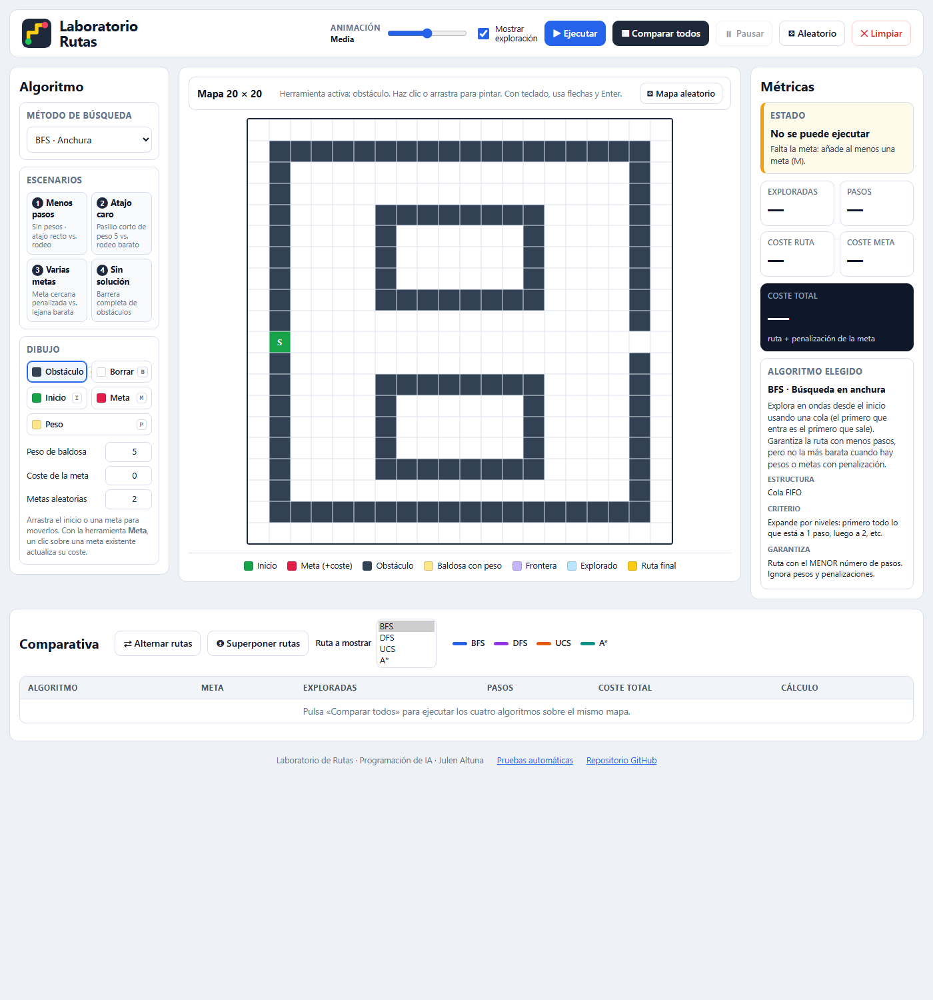

## T04 · Varias metas

| | |
|---|---|
| **Entrada** | Escenario 3: inicio (10,2); metas G (10,6) +25, H (2,17) +0, I (18,17) +5. |
| **Esperado** | BFS → G (4 pasos, total 29). UCS y A\* → H (23 pasos, total 23). |
| **Obtenido** | BFS: meta (10,6) · 4 pasos · 4 + 25 = 29 · 31 exploradas DFS: meta (2,17) · 67 pasos · 67 + 0 = 67 · 68 exploradas UCS: meta (2,17) · 23 pasos · 23 + 0 = 23 · 320 exploradas A\*: meta (2,17) · 23 pasos · 23 + 0 = 23 · 24 exploradas |
| **Estado** | ✔ PASA |

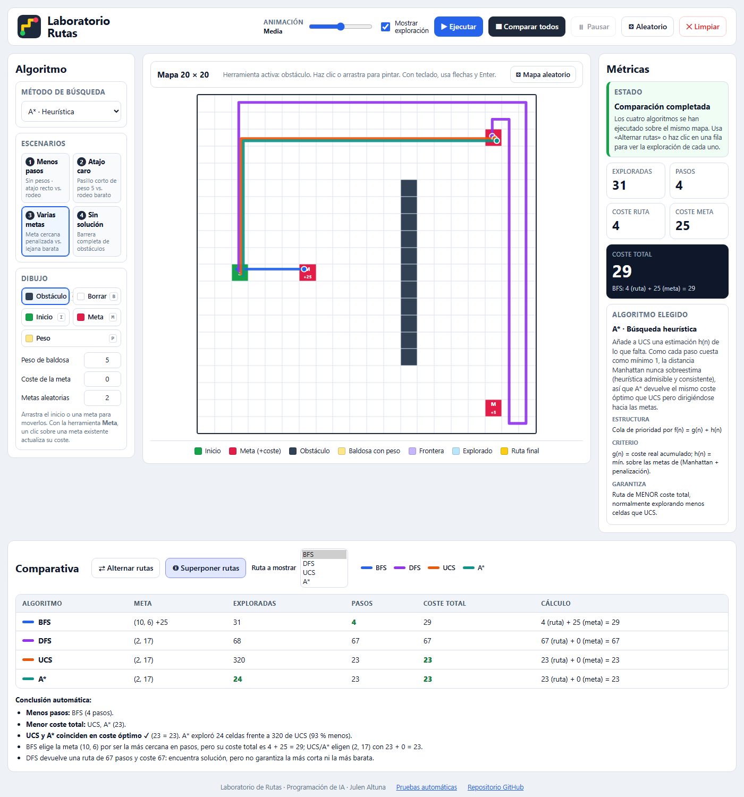

## T05 · Pesos

| | |
|---|---|
| **Entrada** | Escenario 2: pasillo recto con 14 baldosas de peso 5 entre muros, frente a un rodeo sin pesos. |
| **Esperado** | BFS: 17 pasos, coste 73 (pasillo). UCS y A\*: 21 pasos, coste 21 (rodeo). |
| **Obtenido** | BFS: 17 pasos · 73 + 0 = 73 · 240 exploradas DFS: 57 pasos · 57 · 58 exploradas UCS: 21 pasos · 21 · 299 exploradas A\*: 21 pasos · 21 · 26 exploradas |
| **Estado** | ✔ PASA |

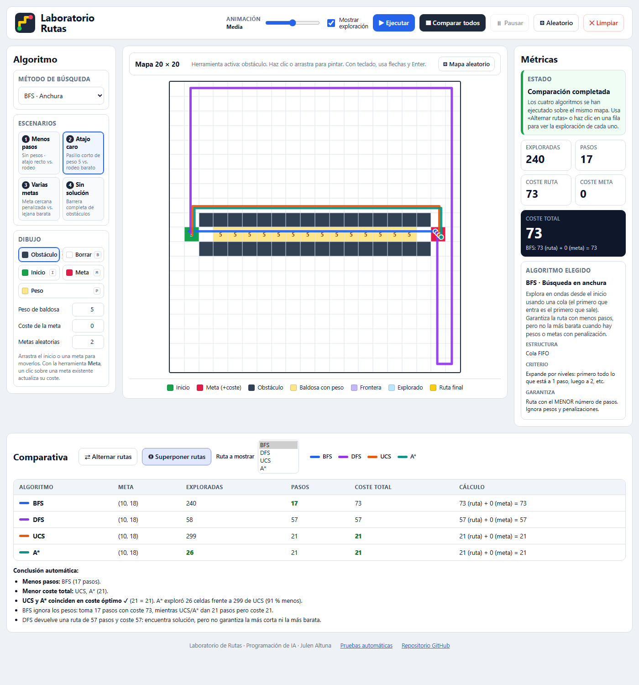

## T06 · Obstáculos

| | |
|---|---|
| **Entrada** | Muro en la columna 10 (filas 0–18, hueco en la fila 19). Inicio (10,0), meta (10,19). |
| **Esperado** | Todos rodean el muro por la fila 19 sin pisar obstáculos. BFS/UCS/A\*: 37 pasos. DFS ≥ 37. |
| **Obtenido** | BFS: 37 pasos · 327 exploradas DFS: 77 pasos · 78 exploradas UCS: 37 pasos · 327 exploradas A\*: 37 pasos · 191 exploradas. Todas las rutas pasan por (19,10) y ninguna pisa un muro. |
| **Estado** | ✔ PASA |

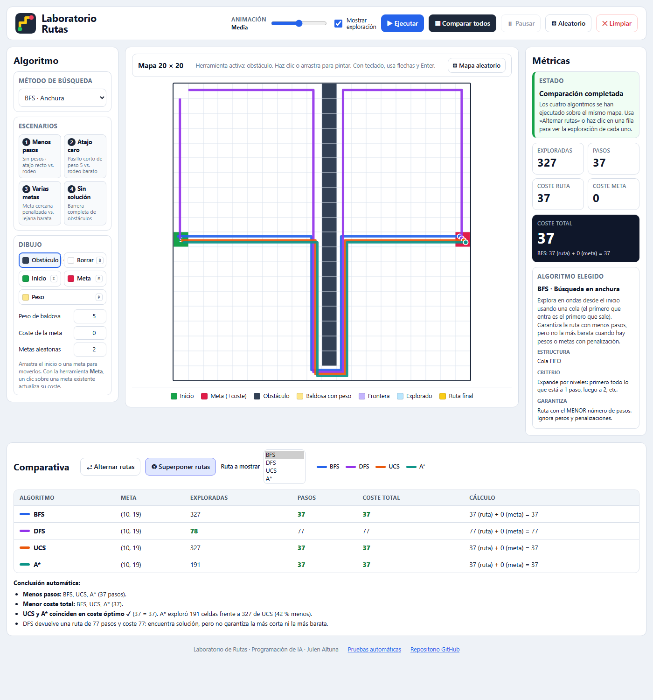

## T07 · Mapa sin solución

| | |
|---|---|
| **Entrada** | Escenario 4: barrera completa en la columna 10; metas en la mitad derecha. |
| **Esperado** | Los 4 terminan con “sin ruta” tras explorar exactamente todas las celdas alcanzables. |
| **Obtenido** | Celdas alcanzables = 190. BFS, DFS, UCS y A\*: sin ruta · 190 exploradas. Interfaz: estado **“Sin solución”**, coste total ∞ y conclusión “ninguna meta es alcanzable”. |
| **Estado** | ✔ PASA |

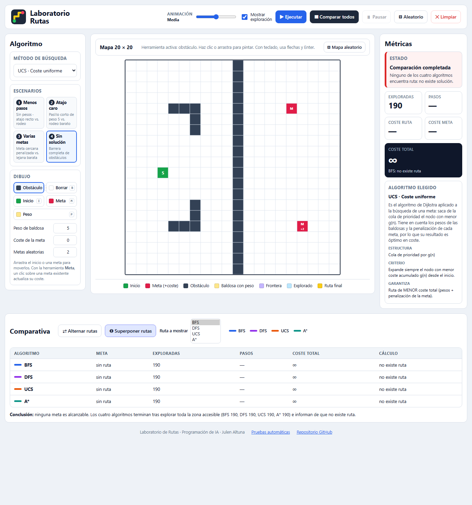

## T08 · Edición del tablero tras ejecutar

| | |
|---|---|
| **Entrada** | Escenario 1 → Comparar todos (se muestra UCS). Después se pinta un muro en (10,9), que está sobre la ruta, y se vuelve a comparar. |
| **Esperado** | 1ª ejecución: 17 pasos. Al editar, los resultados se invalidan (sin ruta dibujada, métricas “—”, tabla marcada como desactualizada). 2ª ejecución: la ruta ya no pasa por (10,9) y tiene 19 pasos. |
| **Obtenido** | Antes → BFS 17 pasos, UCS 17 pasos. Después → BFS 19 pasos, UCS 19 pasos; la ruta pisa (10,9): *false*. El resultado anterior no se modifica. |
| **Estado** | ✔ PASA |

| Antes de editar | Tras editar (resultados invalidados) | Tras volver a ejecutar |
|---|---|---|
| 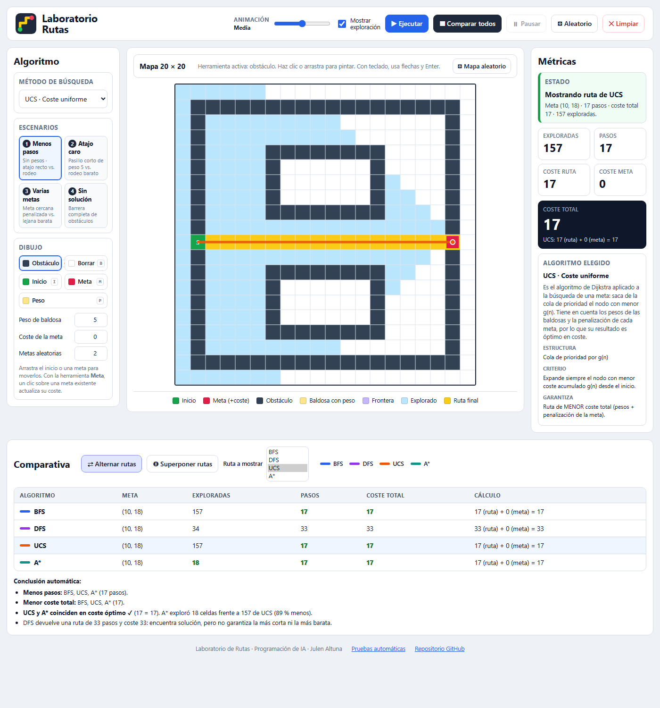 | 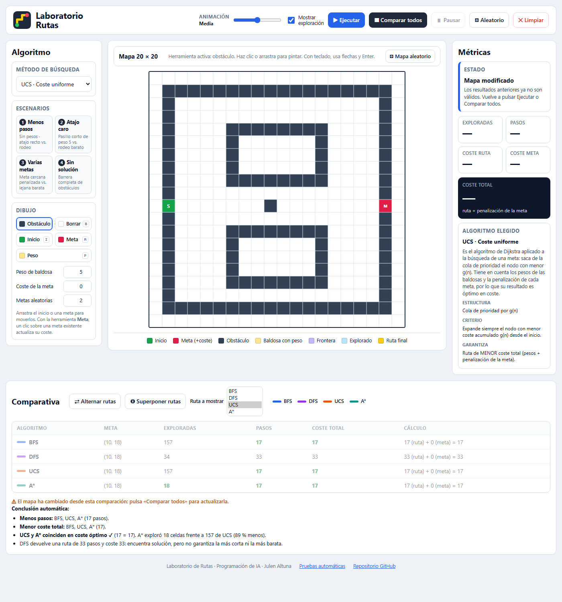 | 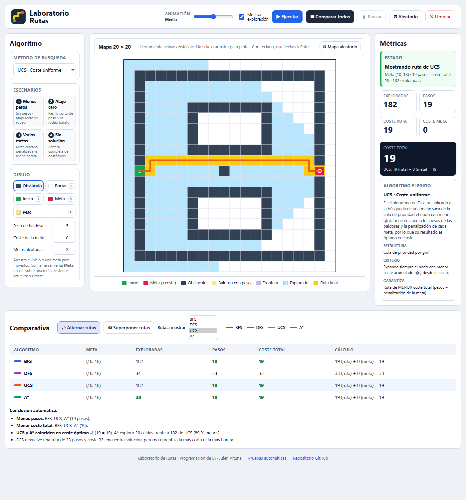 |

## T09 · Coherencia del tablero

| | |
|---|---|
| **Entrada** | Inicio (1,1), meta (2,2). Intentar: muro sobre la meta, inicio sobre la meta, meta sobre el inicio, segundo inicio en (3,3), meta con penalización −3, peso 0. |
| **Esperado** | Se rechazan los estados incoherentes; solo existe un inicio (se mueve a (3,3)); penalización → 0; peso → 2. |
| **Obtenido** | muro sobre meta: *false*; inicio sobre meta: *false*; meta sobre inicio: *false*; nº de inicios: 1 en (3,3); penalización: 0; peso: 2. |
| **Estado** | ✔ PASA |

## T10 · Penalización de la meta

| | |
|---|---|
| **Entrada** | Tablero vacío, inicio (0,0), una meta (0,3) con penalización 7. |
| **Esperado** | Los 4: 3 pasos, coste de ruta 3, coste total 3 + 7 = 10. |
| **Obtenido** | BFS, DFS, UCS y A\*: 3 pasos · coste 3 + 7 = 10. |
| **Estado** | ✔ PASA |

En la interfaz, la captura del escenario 3 con BFS muestra el desglose *4 (ruta) + 25 (meta) = 29*:

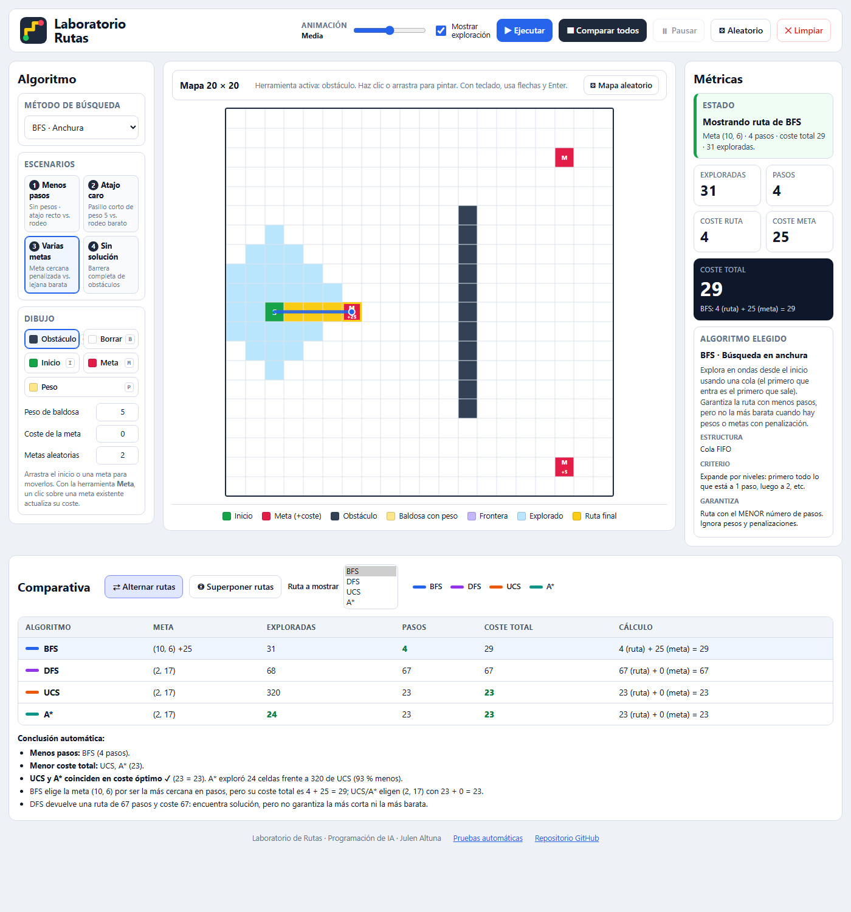

## T11 · UCS y A\* coinciden en coste óptimo

| | |
|---|---|
| **Entrada** | Los 4 escenarios + 500 mapas aleatorios (semillas 1–500, pesos 2–9, 1–4 metas con penalización 0–10). |
| **Esperado** | En todos los mapas UCS y A\* obtienen el mismo coste total (o ambos sin ruta). |
| **Obtenido** | Mapas comprobados: 504; discrepancias de coste: **0**; A\* exploró ≤ celdas que UCS en 504/504. |
| **Estado** | ✔ PASA |

## T12 · Movimiento ortogonal y rutas válidas

| | |
|---|---|
| **Entrada** | Rutas de los 4 algoritmos en 200 mapas aleatorios (semillas 1000–1199, 2 metas). |
| **Esperado** | Todas empiezan en S, terminan en una meta, avanzan de 1 en 1 sin diagonales y no pisan muros; BFS nunca tiene más pasos que otro algoritmo. |
| **Obtenido** | Rutas comprobadas: 788; inválidas: 0; casos con BFS más largo: 0. |
| **Estado** | ✔ PASA |

## T13 · Binary Search y cola de prioridad

| | |
|---|---|
| **Entrada** | `binarySearch([1,3,5,7,9,11], x)` para x = 7, 1, 11, 4. Cola: push(A,5), push(B,2), push(C,5), push(D,1). |
| **Esperado** | Índices 3, 0, 5, −1. Orden de salida D, B, A, C (empate A/C → orden de llegada). |
| **Obtenido** | Índices 3, 0, 5, −1 · orden D, B, A, C. |
| **Estado** | ✔ PASA |

## T14 · Reproducibilidad

| | |
|---|---|
| **Entrada** | Cargar dos veces cada escenario y generar dos veces el mapa aleatorio de semilla 42. |
| **Esperado** | Mismo tablero y mismos resultados en ambas cargas. |
| **Obtenido** | Escenarios idénticos: *true*; semilla 42 idéntica: *true*. |
| **Estado** | ✔ PASA |
